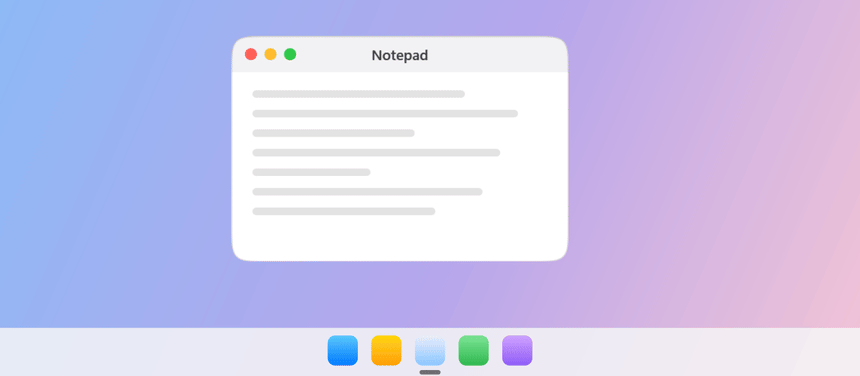
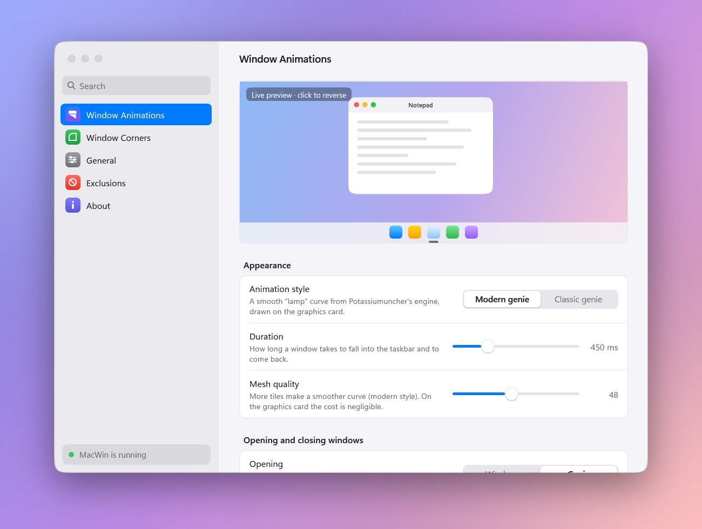
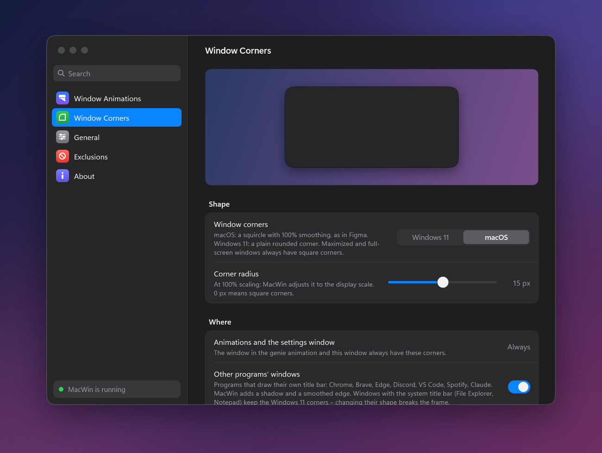
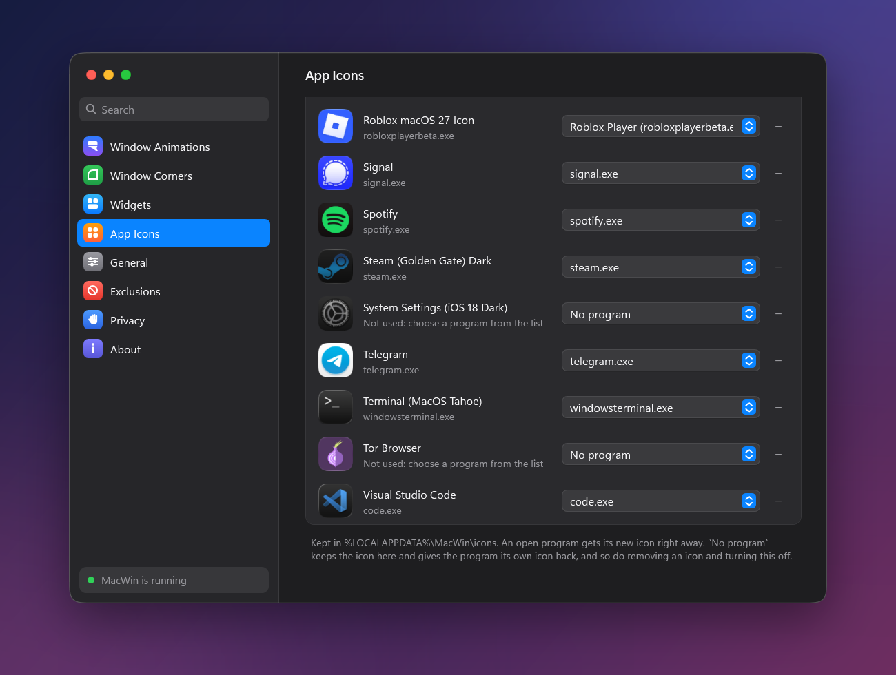
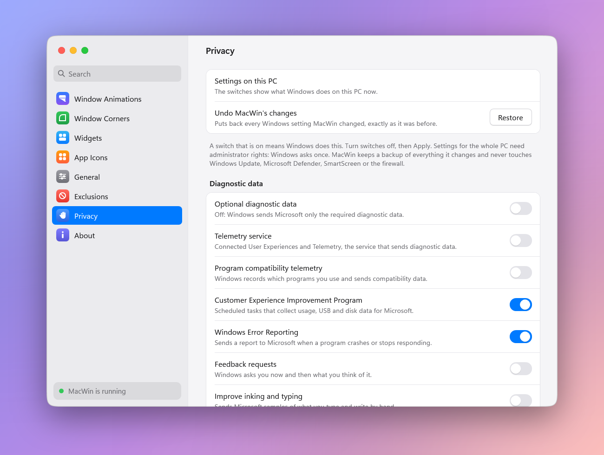
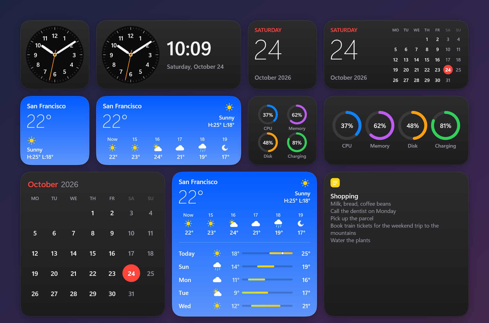
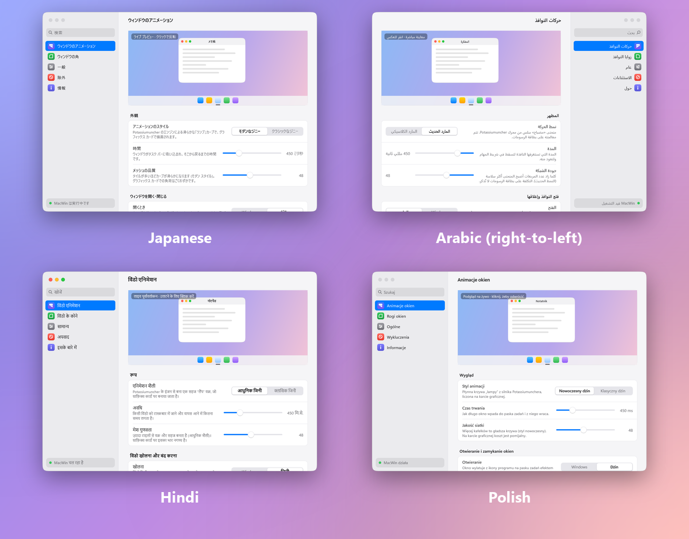

<div align="center">


# MacWin

**The macOS look for Windows 11: the genie effect, squircle corners, desktop widgets and app icons.**

Windows fall into the taskbar like a genie and fly back out, and get soft macOS-style corners.
Your desktop gets macOS widgets, your programs get the icons you like, and Windows gets a
little quieter about your data. Light, free and open source.

[](https://github.com/IMoggsYou/Lampwin/releases/latest)
[](https://github.com/IMoggsYou/Lampwin/releases)
[](https://github.com/IMoggsYou/Lampwin/actions/workflows/build.yml)
[](#requirements)
[](#languages)
[](LICENSE)

### [⬇&nbsp; Download MacWin for Windows 11](https://github.com/IMoggsYou/Lampwin/releases/latest)



**English** · [Polski](README.pl.md)

<sub>This repository was called MacWin until version 1.4.0; old links lead here.</sub>

</div>

---

## Features

- 🧞 **Genie effect** — minimized windows pour into their own taskbar icon and flow back out
  on restore, drawn on the GPU with a smooth "lamp" curve (or the classic funnel), the
  window's shadow travelling along. Prefer something calmer? The **scale** effect shrinks
  the window into its icon in one soft glide.
- 🪟 **Opening and closing** with the genie, from and into the program's taskbar icon.
- ↩️ **Reversible mid-flight** — click again while it is still moving and the genie turns
  around from exactly where it is. Win+D animates every window at once.
- ⬛ **Squircle corners** — the macOS shape (100% smoothing) or the Windows 11 rounding,
  for the animation, the settings window and apps that draw their own title bar
  (Chrome, Edge, Brave, Discord, VS Code, Spotify, …), with a matching shadow.
- 🗓️ **Desktop widgets** — a clock, a calendar, the weather, system gauges, a note, a
  photo, a countdown to a day of your choice and what's playing now, light or dark. They stay on the desktop under your windows and
  snap to a grid like on macOS; drag them anywhere, right-click for size and look.
- 🎨 **App icons** — give any program an icon of your own: on its windows, in Alt+Tab, on
  the taskbar and in the Start menu. Drop in macOS `.icns`, PNG, JPEG, WebP, HEIC, ICO or
  take one from another program; MacWin trims it to the size of Windows icons and finds
  the program from the file name. A set of macOS-style icons comes included. Save your
  setup as an **icon set**, switch back to the **Windows icons** in one click, or remove
  everything.
- 🔒 **Privacy switches** — turn off Windows telemetry, the advertising ID, ads and tips in
  Start and on the lock screen, web results in search, Copilot, Recall and more. Every value
  is backed up first and **Restore** undoes it all; Windows Update, Defender, SmartScreen
  and the firewall are never touched.
- ⚙️ **A settings window like macOS System Settings** — live preview, search, light and
  dark mode, per-app exclusions.
- 🌍 **11 languages**, picked automatically from Windows (see [Languages](#languages)).
- 🔄 **Automatic updates** from GitHub, verified with SHA-256 — installed in the background,
  or offered with a short "what's new" when you open the settings.
- 🚀 **Starts with Windows**, sits in the notification area, uses no CPU while idle.
- 🛡️ **Safe by design** — stays out of system processes and anti-cheat games, falls back
  to the normal Windows animation whenever anything goes wrong, and
  **Ctrl+Alt+Shift+F12** turns it off instantly.
- 🖥️ **Any PC with Windows 11** — AMD, Intel and NVIDIA graphics, or none at all (it then
  draws on the CPU). 32-bit apps and apps running as administrator are animated too.

## Screenshots

<p align="center">
  
  
</p>

<p align="center">
  
  
</p>

<p align="center">
  
</p>

## Install

1. Download **`MacWinSetup-x.y.z.exe`** from the
   [latest release](https://github.com/IMoggsYou/Lampwin/releases/latest).
2. Run it. If the .NET 10 Desktop Runtime (needed by the settings window) is missing, the
   installer downloads it from Microsoft for you.
3. Done — minimize any window. MacWin starts with Windows; its icon is in the
   notification area (click it for the settings).

> [!NOTE]
> MacWin is not code-signed yet, so Windows SmartScreen may say *"Windows protected your
> PC"*. Click **More info → Run anyway**. Every release is built by GitHub Actions from
> this repository, with a published SHA-256 (`SHA256SUMS.txt`) and a
> [build provenance attestation](https://github.com/IMoggsYou/Lampwin/attestations).

### Requirements

| | |
| --- | --- |
| Windows | Windows 11 (22H2 or newer recommended), 64-bit **x64** |
| Graphics | Any: AMD, Intel, NVIDIA, or none (Direct3D 11 / WARP) |
| Disk | ~20 MB, most of it the included icons (+ the .NET 10 Desktop Runtime for the settings window) |
| Not supported yet | Windows on ARM (Snapdragon PCs) |

### Uninstall

**Settings → Apps → Installed apps → MacWin → Uninstall.** It asks whether to remove your
settings too.

## Languages

MacWin speaks your language: it follows the Windows display language and falls back to
English. You can also pick one in **Settings → General → Language**.

| | | | |
| --- | --- | --- | --- |
| English | Polski | 简体中文 (Chinese) | हिन्दी (Hindi) |
| Español | Français | العربية (Arabic) | বাংলা (Bengali) |
| Русский (Russian) | Português (Brasil) | 日本語 (Japanese) | |

<p align="center">
  
</p>

Spotted a clumsy translation? Native speakers are very welcome to fix it — see
[docs/TRANSLATING.md](docs/TRANSLATING.md); no build needed.

## Light on your PC

Measured on Windows 11 with an NVIDIA GeForce RTX 2070, MacWin 1.0.0, idle for 30 seconds:

| Process | CPU while idle | Memory |
| --- | --- | --- |
| `MacWin.exe` (tray, renderer) | 0 ms | ~52 MB (mostly the GPU driver) |
| `MacWinHelper32.exe` (32-bit apps) | 0 ms | ~9 MB |
| `MacWinHook64.dll` in each app | — | ~340 KB image |

Nothing runs between animations: no polling, no timers. A genie frame takes about
0.3 ms of CPU.

Desktop widgets cost nothing until you add one. A widget is redrawn only when something on
it changes — once a minute, every two seconds for the system gauges, every second for a
clock with a second hand (about 0.4 ms of CPU per tick, only the hands are drawn again) —
and not at all while the screen is off, the PC is locked or a full-screen game is running.

## Privacy

MacWin collects nothing. It goes online for two things only:

- **Updates:** once a day it asks the GitHub API whether a new release exists, and
  downloads it from GitHub if you choose to update. You can turn it off in
  **Settings → General → Updates**.
- **Weather**, only while a Weather widget is on the desktop: every 30 minutes MacWin asks
  [Open-Meteo](https://open-meteo.com) for the forecast. With **Use my location** (on by
  default) the place comes from Windows location services, and
  [OpenStreetMap](https://nominatim.openstreetmap.org) names the town, asked only when the
  PC has moved. Both get coordinates rounded to about a kilometre, never more precise.
  Searching for a place by hand sends Open-Meteo the name you typed. Nothing else is sent,
  and there is no account or key. Windows' own location switch
  (**Settings → Privacy & security → Location**) turns the location part off.

App icons, the Privacy page and the other widgets work entirely on your PC. The Now playing
widget shows what Windows' own media controls show (the song, the artist, the app); it reads
that on your PC, only while the widget is on the desktop.

## FAQ

<details>
<summary><b>Is it safe for games with anti-cheat?</b></summary>

MacWin never loads into games installed in the Steam, Epic, Riot, Xbox, EA, Ubisoft or
GOG game folders, into games shipping EasyAntiCheat or BattlEye, or into a list of known
anti-cheat games. You can add any program or folder under **Settings → Exclusions →
Never load MacWin**.
</details>

<details>
<summary><b>Something looks wrong. How do I turn it off right now?</b></summary>

Press **Ctrl+Alt+Shift+F12**. MacWin quits and every window behaves normally again. Then
please [report the problem](https://github.com/IMoggsYou/Lampwin/issues/new/choose) with the
log (`%LOCALAPPDATA%\MacWin\host.log`).
</details>

<details>
<summary><b>Why does MacWin ask for administrator rights during installation?</b></summary>

It installs into Program Files and registers a scheduled task, so it can start with
Windows and animate programs that run as administrator — without a UAC prompt at every
sign-in.
</details>

<details>
<summary><b>Why do File Explorer and Notepad keep the Windows 11 corners?</b></summary>

Windows with the system title bar break when their shape is changed. MacWin gives the
squircle to the genie, its own window and apps that draw their own title bar.
</details>

<details>
<summary><b>How do I get a program's own icon back?</b></summary>

In **Settings → App Icons** pick **No program** next to the icon, or press **Use Windows
icons** to give every program its own icon back (your icons stay in the list). Pinned
taskbar icons refresh after **Restart File Explorer**.
</details>

<details>
<summary><b>Will the Privacy page break Windows Update or my antivirus?</b></summary>

No. It only has switches for telemetry, ads and similar features, never for Windows Update,
Microsoft Defender, SmartScreen, the firewall or UAC. Each value is backed up before it
changes, and **Restore** puts back exactly what was there.
</details>

<details>
<summary><b>Does it work with multiple monitors and an auto-hidden taskbar?</b></summary>

Yes. The auto-hidden taskbar slides out while a window minimizes; on multiple monitors
the genie can target the taskbar on the window's monitor (Settings → Window Animations).
</details>

## Build from source

```powershell
cmake --preset x64
cmake --build --preset x64
ctest --test-dir build/x64
cmake --build --preset x64 --target MacWinSetup   # installer
```

You need llvm-mingw, CMake, Ninja, the .NET 10 SDK and Inno Setup 6 — see
[docs/BUILDING.md](docs/BUILDING.md) and [docs/ARCHITECTURE.md](docs/ARCHITECTURE.md).

## Contributing

Bug reports, ideas, translations and code are welcome. Please read
[CONTRIBUTING.md](CONTRIBUTING.md) (and [AGENTS.md](AGENTS.md) if you work with an AI
coding assistant). Security issues: [SECURITY.md](SECURITY.md).

If you like MacWin, a ⭐ helps others find it.

## Credits

- The genie animation logic is ported from the Windhawk mod
  [MacOS Minimize Animation](https://github.com/Abdullah-Masood-05) by Abdullah Masood,
  with the genie engine by [Potassiumuncher](https://github.com/Potassiumuncher) (MIT).
- [MinHook](https://github.com/TsudaKageyu/minhook) by Tsuda Kageyu (BSD 2-Clause).

Full notices: [THIRD_PARTY_NOTICES.md](THIRD_PARTY_NOTICES.md).

## License

Created by **[IMoggsYou](https://github.com/IMoggsYou)**. Copyright © 2026 IMoggsYou.

MacWin is free software under the [GNU General Public License v3.0 or later](LICENSE),
with the additional terms in [NOTICE](NOTICE): keep the author attribution, mark modified
versions and give them another name and icon ([TRADEMARKS.md](TRADEMARKS.md)).

macOS is a trademark of Apple Inc.; Windows is a trademark of Microsoft Corporation.
MacWin is not affiliated with either.
