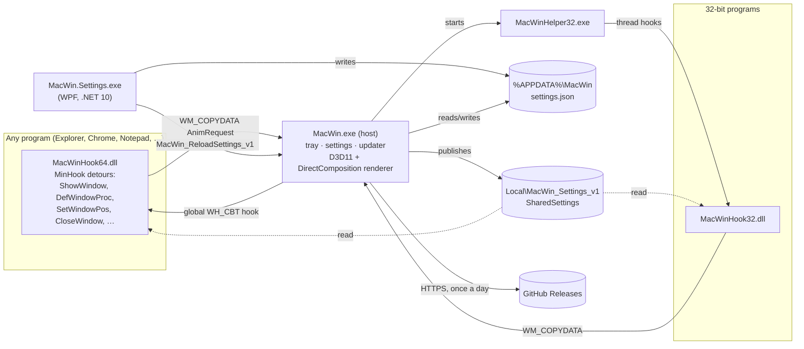

# Architecture

MacWin is three programs and a DLL that cooperate through a few named Windows objects.

## A minimize, step by step

1. A program minimizes a window: `ShowWindow(SW_MINIMIZE)`, the title bar's minimize
   button (`WM_SYSCOMMAND` → `DefWindowProc`), `SetWindowPlacement`, `CloseWindow`, or a
   `HCBT_MINMAX` from another process (Win+D).
2. The hook DLL's detour (`src/hook/effects/genie_hooks.cpp`) captures the window with
   `PrintWindow(PW_RENDERFULLCONTENT)` into a pagefile section, cloaks the window and sends
   an `AnimRequest` (`src/common/ipc.h`) to the host with `WM_COPYDATA` (150 ms timeout).
3. The host (`src/host/ipc_server.cpp`) duplicates the handles, asks the taskbar locator
   (UI Automation) where the program's taskbar button is, and queues a `GenieJob`.
4. The render thread (`src/host/render/device.cpp`) uploads the snapshot, warps it with
   the genie mesh (`genie.hlsl`) frame by frame on the compositor clock into a
   DirectComposition swap chain in a transparent topmost window, and signals the DLL's
   events (first frame, done).
5. The DLL lets the real minimize happen behind the animation and uncloaks the window.
   If anything fails on the way, the DLL undoes its changes and Windows animates as usual.

Restores, opening and closing work the same way in the other direction. A minimize
snapshot is kept on the GPU (`snapshot_cache`, budget by GPU memory) so the restore can
show the window before it is visible.

## Window corners

`src/hook/effects/corners.cpp` cuts windows that draw their own title bar (Chromium,
Electron) to a squircle with `SetWindowRgn`, turns off the DWM border and backdrop for
them, and adds two helper windows: a DirectComposition "shade" for the shadow and
antialiased edge, and a transparent "grip" so the resize border still works.

## Safety

- The DLL refuses to load into system processes and next to anti-cheat (`dllmain.cpp`),
  and into everything on the `noInject` list (exact names or folder patterns).
- Every hook has a fast path; the slow path counts itself (`HookScope`) so the DLL can
  drain all calls before it unhooks and unloads.
- The host holds an "alive" mutex: if it dies, the mutex is abandoned, every DLL unhooks
  itself and the windows come back. The scheduled task restarts the host.
- Elevated, the host only runs from Program Files (only administrators can replace the DLL
  there); shared objects get explicit security descriptors (`elevation.cpp`).

## Desktop widgets

`src/host/widgets/` puts widgets (clock, calendar, weather, system gauges, note, photo) on
the desktop. The settings app adds and configures them in `settings.json` (`widgets`);
the host places them and saves where they are dragged (`monitor`, `col`, `row`), and the
settings app never writes those.

- **A thread of their own** (`widget_host.cpp`), started only while a widget is shown. The
  main thread sends it copies of the settings and texts and never waits for it; edits made
  on the desktop come back as posted messages and are saved by the main thread.
- **Two layered windows per widget**: a click-through shadow and the card above it, both
  owned by the desktop window (`Progman`), so they always sit right above the wallpaper
  and under every program, and "Show desktop" leaves them alone. Explorer restarting
  (`TaskbarCreated`) recreates them.
- **Drawing** (`canvas.cpp`, `widget_draw.cpp`): Direct2D's software rasterizer into a
  premultiplied DIB, shown with `UpdateLayeredWindow`; no GPU memory. Cards use the same
  squircle as the windows. A clock's face is drawn once and only its hands every tick.
- **Grid** (`widget_layout.cpp`): cells of 164 DIPs (times the monitor's scale and the size
  setting) from the top-right of each monitor's work area; a drop snaps to the nearest
  free slot. A widget whose monitor is gone shows on the main one without losing its slot.
- **Timers**: one coalescable timer for the next change (the next second, minute or gauge
  sample); nothing while the session is locked, the display is off or a full-screen app runs.
- **Weather** (`weather.cpp`, `location.cpp`): every 30 minutes, only with a Weather widget,
  on a worker thread: Windows' position (WinRT `Geolocator`, rounded to 0.01°) or the chosen
  place when Windows won't tell or only guesses (accuracy over 5 km), the town's name from
  Nominatim when the PC moved more than 3 km, then the Open-Meteo forecast. The last answer
  is kept in `%LOCALAPPDATA%\MacWin\weather.json` (shown right after a restart), and what
  the location lookup found in `location.json` for the settings window.

## Settings and languages

`settings.json` is written by the settings app and the host; both keep keys they don't
know. The host publishes the values into the shared section the DLLs read (a seqlock,
`common/settings.h`). The UI language (`language`: `auto` or a code) is resolved the same
way in C# (`Loc.cs`) and C++ (`i18n.cpp`) from `i18n/*.json`.

## Updates

`src/host/updater.cpp`: at most once a day (or on request) the host asks the GitHub API
for the latest release, downloads `MacWinSetup-X.Y.Z.exe` and `SHA256SUMS.txt` from that
release (github.com / *.githubusercontent.com only), checks the SHA-256, and runs the
installer silently. The state is written to `%LOCALAPPDATA%\MacWin\update.json` for the
settings window.
